# TP : Architecture Événementielle avec Kafka & Spring Cloud Stream

Mise en place d'une architecture event-driven avec Kafka, Spring Cloud Stream, et Kafka Streams pour du traitement de données en temps réel.

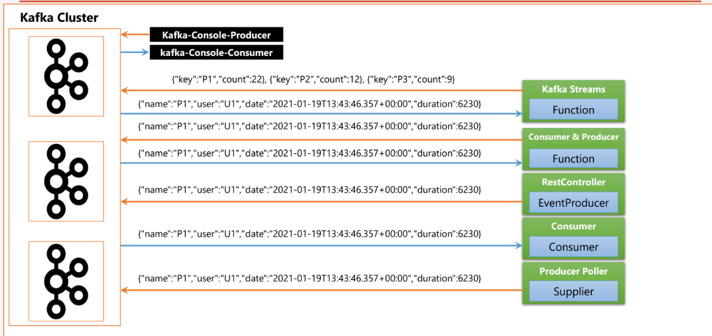
##  Étapes

### 1. Démarrage Kafka

Après ajouter un  fichier compose.yml pour kafka et zookepper , on a demaré le service kafka avec commande docker compose - up
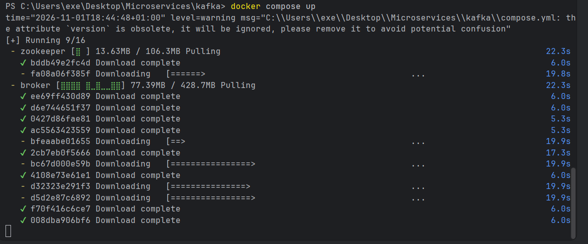

Une fois les conteneurs démarrés (`zookeeper` et `kafka-broker`), on vérifie qu'ils tournent bien avec `docker ps` :
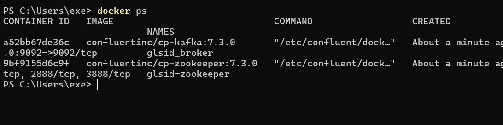

---

### 2. Test avec Kafka Console

On teste d'abord le broker avec un **producer** et un **consumer** en ligne de commande via `docker exec` :

- On lance un **consumer** sur le topic `T1` :
  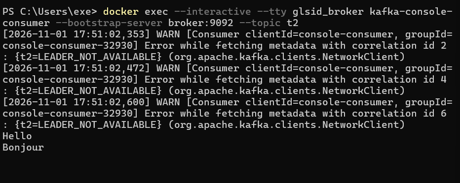
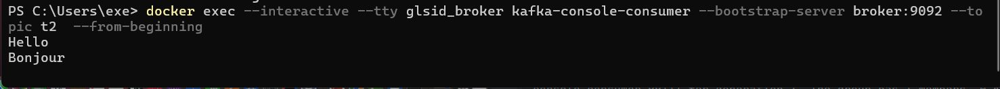

- Puis on lance un **producer** sur le même topic et on envoie un message :
  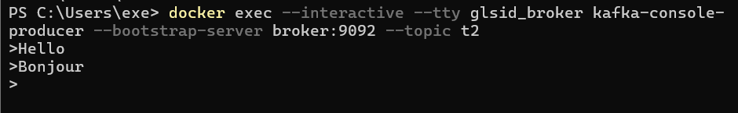

> Le consumer reçoit bien le message envoyé par le producer.

On remarque un petit **délai** dans la réception des messages : c'est dû au fait que le Kafka Consumer utilise la technique du **polling** (par défaut toutes les 1 seconde).

---

### 3. Création d'un REST Controller (Producer Spring)

On crée un `RestController` qui publie un `PageEvent` (nom de page, utilisateur, date, durée) dans un topic Kafka via **StreamBridge** de Spring Cloud Stream :

- On teste avec un consumer sur console kafka en premier :
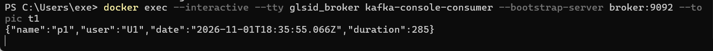

- Puis on teste avec un appel HTTP `/publish?name=P1&topic=T1` et on vérifie que le message arrive bien dans le topic :
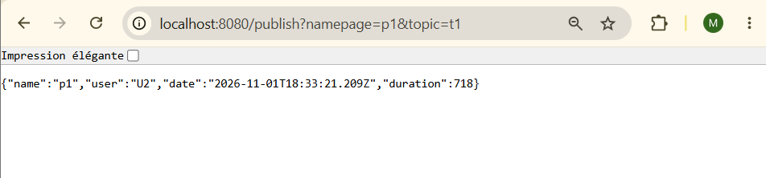

---

### 4. Création d'un Consumer Spring

On crée un `Consumer<PageEvent>` annoté avec `@Bean` pour consommer les messages d'un topic. Il faut déclarer la destination et la fonction dans `application.properties` :
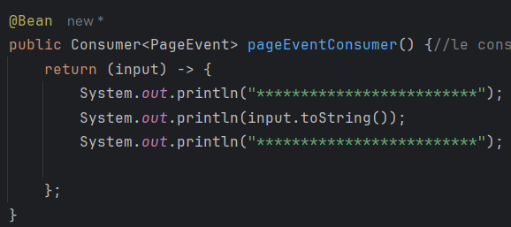

On redémarre et on vérifie dans la console que les messages sont bien consommés :
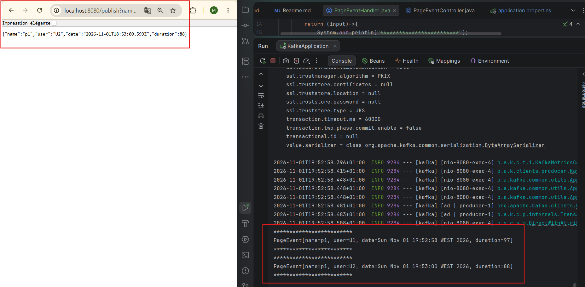

---

### 5. Création d'un Supplier (Producer automatique)

On crée un `Supplier<PageEvent>` qui génère automatiquement un événement à intervalle régulier (par défaut 1s, réglable via `spring.cloud.stream.poller.fixed-delay`) :
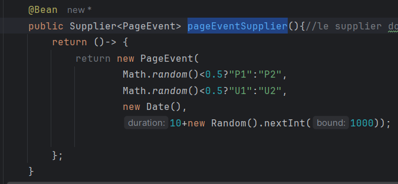

On déclare le binding `out-0` vers un topic (ex: `T3`), puis on observe le flux de messages arriver chaque seconde dans le topic :
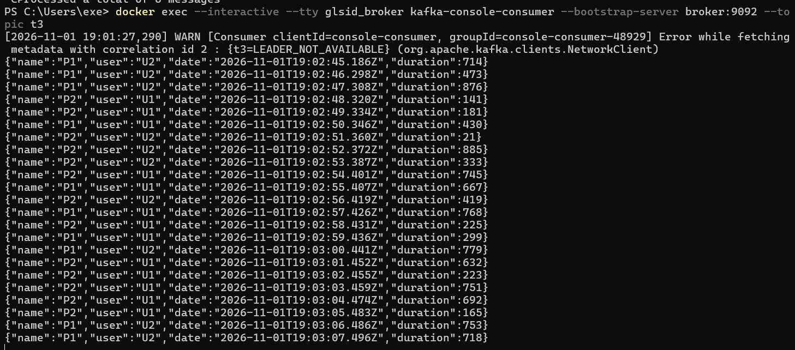

---

### 6. Kafka Streams (Traitement temps réel)

On crée une `Function<KStream, KStream>` qui consomme le stream produit par le supplier (`T3`), applique un `filter`, un `map`, un `groupByKey`, un `windowedBy(5 secondes)` et un `count`, puis publie le résultat dans un autre topic (`T4`) :
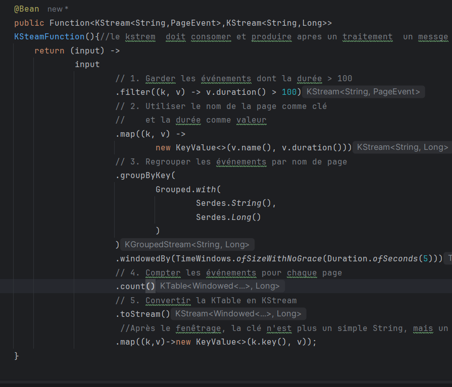

Configuration des bindings `in-0` / `out-0` et du `commit.interval.ms` pour un rendu temps réel :
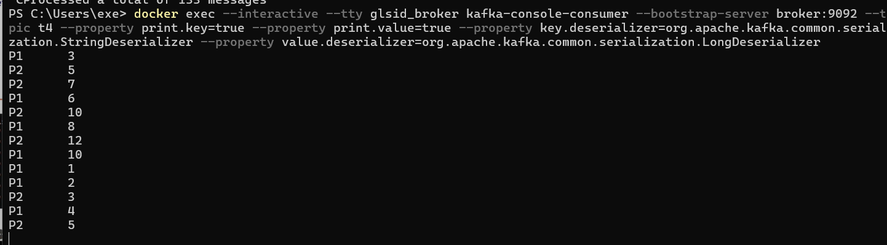

---

### 7. Visualisation Temps Réel

On expose un endpoint `/analytics` en **Server-Sent Events** (`TEXT_EVENT_STREAM`) qui lit le `count-store` (KTable matérialisée par Kafka Streams) et pousse les résultats au frontend chaque seconde :
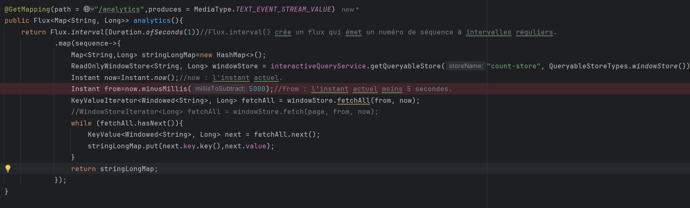

Côté frontend, une simple page `index.html` utilise **Smoothie Charts** et un `EventSource` pour afficher en temps réel le nombre de visites des pages P1 et P2 sur les 5 dernières secondes :
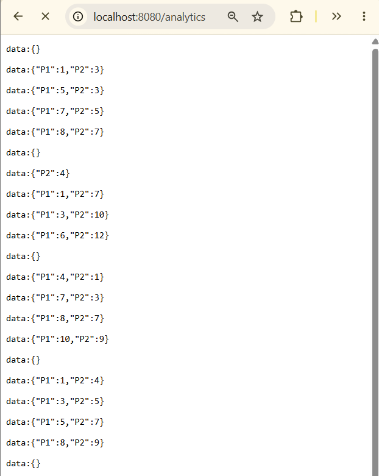

Résultat final : un dashboard qui affiche les deux courbes (P1 en vert, P2 en rouge) mises à jour en temps réel :
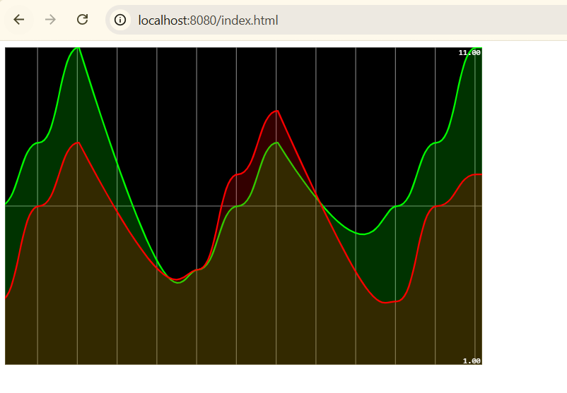