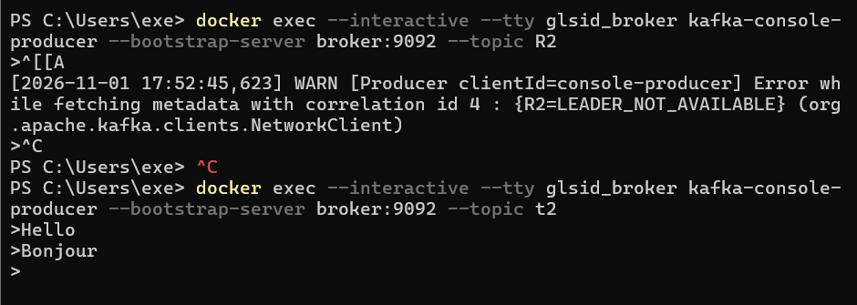

apres ajouter fichier compose.yml pour kafka et zookepper , on a demaré avec commande docker compose up 

tester avec kafka console consumer et producer

il utilse technique de pulling

crer un restcontroller :

